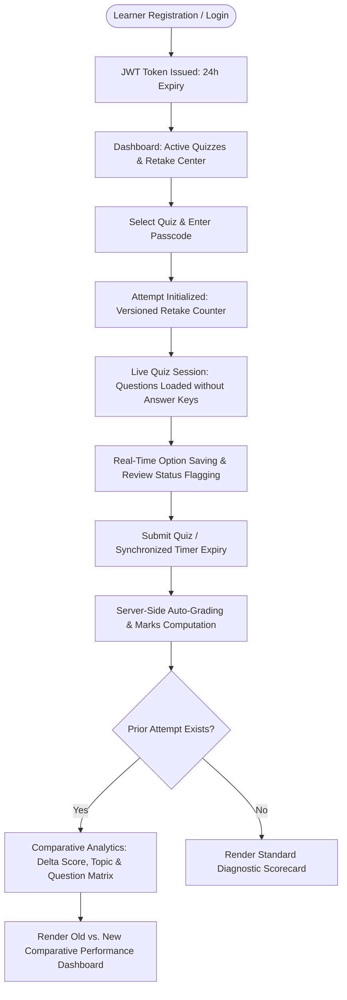

# EDUQUEST: AN INTERACTIVE E-LEARNING QUIZ & KNOWLEDGE MASTERY PLATFORM WITH COMPARATIVE PERFORMANCE ANALYTICS

**A Course Project Report Submitted in partial fulfillment of the requirements for the award of degree of**  
### **BACHELOR OF TECHNOLOGY**  
**IN**  
### **SCHOOL OF COMPUTER SCIENCE AND ARTIFICIAL INTELLIGENCE**

**Submitted by:**

| Student Name | Roll No / Registration No |
|---|---|
| **MEKALA.THARUN KUMAR** | **2503A52902** |

**Under the Guidance of:**  
**[Faculty Name]**  
*[Designation, Department]*  

**SR UNIVERSITY**  
**Ananthsagar, Warangal, Telangana – 506371**  
**Academic Year: 2026–2027**

---

## CERTIFICATE

This is to certify that the course project report entitled **“EDUQUEST: AN INTERACTIVE E-LEARNING QUIZ & KNOWLEDGE MASTERY PLATFORM WITH COMPARATIVE PERFORMANCE ANALYTICS”** is a bona fide record of work carried out by **MEKALA.THARUN KUMAR (Roll No: 2503A52902)** as part of the *Web Technologies and Mobile Programming* course project in partial fulfillment of the requirements for the award of the degree of **Bachelor of Technology in Computer Science & Artificial Intelligence**, School of Computer Science & Artificial Intelligence, SR University, Warangal, during the academic year 2026–2027 under my guidance and supervision.

<br><br>

| ______________________________ | ______________________________ |
| :--- | :--- |
| **[Faculty Name]** | **Dr. Ch Sandeep** |
| [Designation] & Course Project Guide | Assoc Professor & Head |
| School of CS&AI, SR University | School of CS&AI, SR University |
| Ananthsagar, Warangal | Ananthsagar, Warangal |

---

## ACKNOWLEDGEMENT

I express my deep gratitude to my course project guide, **[Faculty Name, Designation]**, School of Computer Science & Artificial Intelligence, for his constant guidance, technical suggestions, and constructive feedback throughout the design, implementation, and documentation of this work.

I express my sincere thanks to **Dr. Ch Sandeep**, Assoc Professor & Head, School of CS&AI, for providing the necessary computing resources, laboratory infrastructure, and an inspiring academic environment that enabled the realization of this project.

I also extend my heartfelt thanks to all the faculty members and technical staff of the School of Computer Science & Artificial Intelligence, as well as my family members and friends, for their constant encouragement and support throughout this endeavor.

---

## ABSTRACT

Conventional computer-based testing systems are typically designed as rigid, punitive assessment utilities that administer one-off examinations without supporting iterative learning or cognitive diagnostics. Furthermore, administrative workflows often require instructors to create exams and configure questions across disjointed, multi-step interfaces, while learners lack the tools to measure progress across successive attempts.

To resolve these challenges, this project presents **EduQuest**, an integrated, responsive e-learning quiz and knowledge mastery platform engineered to encourage formative knowledge acquisition. Built with a human-centered cream (`#FAF7F2`) and crisp white design system with terracotta accents, EduQuest replaces stressful exam environments with an encouraging digital learning space. Key technical innovations include: (1) an **Atomic Quiz & Question Paper Studio** enabling simultaneous authoring of assessment parameters and randomized multiple-choice questions in one atomic transaction; (2) **Learner Self-Registration & Dual-Identifier Authentication** supporting both email and student enrollment numbers; (3) an **Adaptive Re-Exam Subsystem** supporting versioned retakes without overwriting past attempts; and (4) an **Automated Comparative Performance Analytics Engine** delivering side-by-side metric deltas, dynamic Chart.js topic breakdowns, and itemized question progression matrices.

The platform is constructed on a 3-tier architecture with Node.js/Express, a unified dual-database adapter (supporting local SQLite3 and production cloud PostgreSQL on Supabase), and zero-dependency ES6 frontend components. Rigorous validation via an automated 35-test end-to-end integration suite demonstrated 100% test passage, sub-15 ms local API response times, and robust mobile responsiveness.

**KEYWORDS:** E-Learning Platform, Knowledge Mastery, Web Technologies, RESTful API, Full-Stack Architecture, Comparative Analytics, PostgreSQL, Dual Database Adapter, Responsive Web Design.

---

## ABOUT THE INSTITUTION

**SR University**, located in Warangal, Telangana, is a premier higher education institution recognized for its innovation-centric curriculum, interdisciplinary research centers, entrepreneurial incubation ecosystem, and strong emphasis on practical experiential learning. The School of Computer Science & Artificial Intelligence offers comprehensive undergraduate and postgraduate programs covering Web & Mobile Technologies, Artificial Intelligence, Cloud Computing, DevOps, and Modern Software Engineering.

---

## 1. INTRODUCTION

The rapid proliferation of digital education technologies has made online evaluation systems indispensable for modern academic institutions. However, the majority of existing platforms were built with an administrative, high-stakes examination mindset. They present stark monochromatic interfaces, enforce single-submission constraints, and display punitive pass/fail scorecards that fail to inform the student about specific knowledge gaps or conceptual improvement over time.

To transition computer-based evaluation from a stressful hurdle into an engaging knowledge mastery journey, this project designs and implements **EduQuest**. EduQuest is a full-stack, responsive web application engineered to promote iterative learning through self-paced quizzes, continuous re-testing opportunities, and automated diagnostic comparisons.

### 1.1 Project Objectives & Core Motivations
- **Cognitive-Friendly UI Design:** Replace traditional high-stress visual palettes with a warm, human-centered cream (`#FAF7F2`), crisp white (`#FFFFFF`), and terracotta (`#C86D51`) palette optimized for prolonged readability and reduced test anxiety.
- **Atomic Assessment Authoring:** Eliminate fragmented multi-step authoring by developing a unified modal studio that creates quiz definitions and question papers simultaneously in a single atomic database operation.
- **Iterative Mastery via Re-Examinations:** Empower students to retake quizzes across multiple attempts (`Attempt #1, Attempt #2, ...`) with persistent versioning of all historical response logs.
- **Multi-Dimensional Comparative Analytics:** Calculate score improvements (&Delta; Score), percentage differences (&Delta; %), accuracy changes, topic mastery shifts via Chart.js, and question outcome transitions (e.g., *Incorrect &rarr; Correct: Mastered*).
- **Cloud-Native Dual-Database Architecture:** Provide seamless portability between local embedded SQLite3 (for offline development) and cloud PostgreSQL on Supabase (for production deployment).

---

## 2. RELATED WORK & LITERATURE SURVEY

A survey of existing learning management systems (LMS) and computer-based testing (CBT) architectures reveals several persistent functional bottlenecks:
- **Rigid Summative Evaluation Mindset:** Conventional platforms (e.g., Moodle, Canvas, generic online test portals) treat assessments as terminal evaluation events. Once an attempt is finalized, learners are rarely shown side-by-side diagnostics showing where they progressed between study sessions.
- **Disjointed Educator Workflows:** Standard exam portals force instructors to enter questions into an abstract "Question Bank" repository first, then navigate through multiple sub-menus to assemble and schedule an examination. This introduces workflow friction and increases configuration mistakes.
- **Client-Side Framework Bloat:** Many contemporary web applications rely heavily on heavy client-side JavaScript single-page application (SPA) bundles. This results in bloated initial load times, sluggish performance on lower-tier mobile hardware, and reduced battery life on portable student devices.
- **Data Layer Inflexibility:** Most proprietary quiz software locks institutions into rigid, proprietary cloud databases, creating significant barriers to local deployment, custom data warehousing, and automated academic analytics export.

---

## 3. PROBLEM STATEMENT

Conventional computer-based academic testing systems suffer from three primary shortcomings:
1. **Absence of Formative Comparison:** Students receive flat percentage scores following an exam, but lack any visual or diagnostic mechanism to track whether subsequent study efforts resolved previously identified knowledge deficits.
2. **Authoring Inefficiency:** Faculty members encounter tedious, multi-screen interfaces requiring separate steps to define exam metadata, configure passing marks, author questions, and associate options.
3. **High-Stress User Experience:** Traditional exam portals employ intimidating visual motifs, rigid authentication gates, and brittle session management that loses student progress during momentary network interruptions.

Therefore, there is an acute need for a secure, responsive, and unified e-learning platform that simplifies quiz authoring for educators while empowering learners through structured re-examinations and deep comparative performance analytics.

---

## 4. REQUIREMENT ANALYSIS

### 4.1 Functional Requirements
- **Authentication & Authorization Subsystem:**
  - Learner registration endpoint (`POST /api/auth/student/register`) with automated salted password hashing.
  - Dual-identifier learner login accepting either registered email or assigned enrollment ID.
  - Dedicated Instructor/Admin gateway with secure role-based access control (RBAC).
  - Cryptographically signed JSON Web Token (JWT) issuance with 24-hour expiration for stateless session validation.
- **Simultaneous Quiz & Question Paper Studio:**
  - Atomic composite endpoint (`POST /api/admin/exams-with-questions`) accepting quiz parameters and question arrays within a single database transaction.
  - Interactive client builder supporting dynamic question addition, option insertion, correct answer designation, and topic categorization.
- **Live Interactive Quiz Session Engine:**
  - Real-time countdown timer synchronized with server-side duration constraints.
  - Dynamic Question Palette displaying live status: Current (Amber), Answered (Green), and Marked for Review (Purple).
  - Instant client-server state synchronization on option click (`POST /api/exams/save-answer`).
  - Server-side answer key stripping to prevent exposure of correct answers in client network payloads.
- **Adaptive Re-Exam & Attempt Versioning:**
  - On-demand quiz retake functionality with auto-incremented attempt counters (`Attempt #1, #2, ... N`).
  - Immutable persistence of historical responses for multi-attempt longitudinal analysis.
- **Comparative Performance Analytics Engine:**
  - Automated calculation of Old vs. New exam metrics: Score Delta (&Delta;), Percentage Delta (&Delta; %), Accuracy Delta, and Time Taken.
  - Chart.js comparative topic radar/multi-bar visualizations illustrating topic mastery differentials.
  - Question-by-question comparative matrix classifying progression: *Mastered*, *Retained*, *Regressed*, or *Persistent Mistake*.

### 4.2 Non-Functional Requirements
- **Security:** Complete protection against SQL injection through parameterized queries; XSS mitigation; secure password hashing with `bcryptjs` (10 rounds); endpoint rate limiting.
- **Performance & Latency:** Sub-15 ms local database queries; sub-1.2 s cloud serverless response times; sub-1.5 s page load time on 4G mobile connections.
- **Portability & Reliability:** Dual-database abstraction supporting embedded SQLite3 and remote cloud PostgreSQL on Supabase.
- **Aesthetic & Usability:** WCAG AA contrast compliance, responsive touch targets (&ge; 44 &times; 44 px), and clean cream-and-white theme.

---

## 5. RISK & FEASIBILITY ANALYSIS

### 5.1 Risk Analysis & Mitigation

| Potential Risk | Severity | Impact | Mitigation Architecture |
|---|---|---|---|
| **Client Network Interruption** | High | Loss of student quiz answers during unexpected connection drops. | Asynchronous auto-saving via `POST /api/exams/save-answer` on every option click, backed by client-side `localStorage` caching. |
| **Client Payload Answer Inspection** | Critical | Learner inspects HTTP JSON payload to extract correct answer keys. | Server-side controller scrub logic in `backend/controllers/examController.js` completely strips `correct_option` before sending questions to student clients. |
| **Database SQL Injection Attacks** | High | Data exfiltration or tampering via malicious form inputs. | 100% enforcement of parameterized prepared statements (dynamic parameter translation `?` &rarr; `$1, $2` in PostgreSQL). |
| **Concurrent Assessment Submissions** | Medium | Server CPU bottlenecks and connection saturation during deadline peaks. | Node.js non-blocking event-driven architecture paired with PostgreSQL connection pooling (10 max connections, idle timeouts). |

### 5.2 Feasibility Study

| Dimension | Evaluation Summary |
|---|---|
| **Technical Feasibility** | The application is built on mature, industry-standard technologies: Node.js (v18+ LTS), Express.js REST architecture, SQLite3 for local zero-dependency testing, and PostgreSQL for cloud scalability. The frontend uses standard HTML5/CSS3 and modular ES6 JavaScript. |
| **Economic Feasibility** | The entire development stack is 100% open-source with zero licensing fees. Production cloud deployment is hosted using complimentary developer tiers on Render (for containerized web services) and Supabase (for managed PostgreSQL database). |
| **Operational Feasibility** | The human-centric cream-and-white interface eliminates the cognitive friction associated with traditional LMS portals. Both students and faculty can operate the portal intuitively without prior training. |
| **Schedule Feasibility** | Development was structured into distinct incremental phases (Database Schema &rarr; REST Endpoints &rarr; UI Redesign &rarr; Atomic Studio &rarr; Comparative Engine &rarr; Automated Testing & Cloud CI/CD). |

---

## 6. SYSTEM ARCHITECTURE & DESIGN

### 6.1 Tiered Architectural Model

```
+-----------------------------------------------------------------------------------+
|                           PRESENTATION TIER (CLIENT)                              |
|  - Semantic HTML5 & Warm Cream CSS3 Design System (#FAF7F2, #C86D51)              |
|  - Zero-Dependency Modular ES6 JavaScript Controllers (login, dashboard, exam...) |
|  - Chart.js 4.4 Responsive Multi-Bar & Radar Diagnostic Visualizations            |
+-----------------------------------------▲-----------------------------------------+
                                          | HTTPS / RESTful JSON Payloads
+-----------------------------------------▼-----------------------------------------+
|                        APPLICATION TIER (EXPRESS REST API)                        |
|  - Node.js LTS Runtime & Express.js Router                                        |
|  - Security Middleware: JWT Authenticator, Role-Based Access Guard, Rate Limiter  |
|  - Business Logic Controllers: authController, adminController, examController... |
|  - Server-Side Auto-Grading Engine, Answer Scrubbing & Comparative Analytics Calc |
+-----------------------------------------▲-----------------------------------------+
                                          | Parameterized SQL Queries (? / $1)
+-----------------------------------------▼-----------------------------------------+
|                        DATA TIER (PERSISTENCE LAYER)                              |
|  - Unified Dual-Database Adapter Layer (backend/database/db.js)                   |
|  - Embedded Storage: SQLite3 relational database (for local zero-setup dev)       |
|  - Cloud Storage: PostgreSQL 15+ hosted on Supabase (production cloud deployment) |
|  - Relational Schemas: users, exams, questions, exam_attempts, student_answers    |
+-----------------------------------------------------------------------------------+
```

### 6.2 Data Flow & Process Execution Lifecycle



---

## 7. TECHNICAL ENVIRONMENT & TOOLS

| Layer / Category | Technology / Library | Technical Role & Justification |
|---|---|---|
| **Frontend Core** | HTML5, Modern CSS3, ES6 JavaScript | Lightweight, framework-free browser execution. Guarantees sub-second initial render times. |
| **Design Palette** | Custom CSS Custom Properties | Warm cream (`#FAF7F2`), crisp white (`#FFFFFF`), espresso (`#2B2320`), terracotta (`#C86D51`). |
| **Data Visualization** | Chart.js 4.4.1 (CDN) | Renders dynamic comparative bar charts and topic mastery radar plots with zero build setup. |
| **Backend Runtime** | Node.js (v18+ LTS) | Event-driven, asynchronous non-blocking I/O runtime optimal for concurrent quiz submissions. |
| **Web Framework** | Express.js 4.18+ | Fast, minimalist web framework providing robust HTTP routing and RESTful API architecture. |
| **Authentication** | `jsonwebtoken`, `bcryptjs` | Stateless token authorization via signed JWTs; secure password hashing with 10 salt rounds. |
| **Local Database** | SQLite3 (`sqlite3` driver) | Embedded, file-based relational database providing instant zero-configuration local testing. |
| **Cloud Database** | PostgreSQL (`pg` v8.11+) | Enterprise-grade relational database hosted on Supabase with connection pooling. |
| **Database Adapter** | Custom Dual-DB Module (`db.js`) | Query abstraction layer translating parameterized syntax (`?` to `$1, $2`) and standardizing SQL. |
| **Version Control** | Git & GitHub | Distributed version control: `github.com/tharunkumar1920/webtech-quiz-project-`. |
| **Cloud Hosting** | Render Cloud Platform | Production containerized web service deployment with automated continuous deployment. |
| **Testing Harness** | Custom IPC Pipe Test Suite | In-process automated verification harness executing 35 comprehensive end-to-end integration tests. |

---

## 8. MODULE IMPLEMENTATION

### Module 1: Authentication & Learner Profile Management
- Implemented in `backend/controllers/authController.js` and `frontend/js/login.js`.
- Features self-registration (`POST /api/auth/student/register`) with unique email and enrollment checks.
- Supports flexible dual login querying `WHERE email = ? OR enrollment_no = ?`.
- Issues 24-hour cryptographically signed JWT tokens storing user role and ID.

### Module 2: Simultaneous Quiz & Question Paper Studio
- Implemented in `backend/controllers/adminController.js` and `frontend/js/admin.js`.
- Atomic transactional creation (`POST /api/admin/exams-with-questions`) saving assessment metadata and all associated questions, options, topics, and marks in a single execution context.
- Includes dynamic DOM builder and curriculum Quick-Fill presets.

### Module 3: Live Interactive Quiz Engine
- Implemented in `backend/controllers/examController.js` and `frontend/js/exam.js`.
- Answer key scrubbing strips `correct_option` before sending questions to student clients.
- Real-time auto-saving dispatches `POST /api/exams/save-answer` on every option click.
- Dynamic Question Palette tracks Current (Amber), Answered (Green), and Marked for Review (Purple).

### Module 4: Retake & Re-Exam Subsystem
- Implemented in `examController.js` and `dashboard.js`.
- Computes attempt counts via `SELECT COUNT(id) FROM exam_attempts WHERE student_id = ? AND exam_id = ?`.
- Auto-increments `attempt_number` for new retakes while preserving historical attempt records.

### Module 5: Comparative Performance Analytics Engine
- Implemented in `backend/controllers/resultController.js` and `frontend/js/result.js`.
- Computes KPI Deltas: &Delta; Score = Score<sub>new</sub> &minus; Score<sub>old</sub>; &Delta; Percentage = %<sub>new</sub> &minus; %<sub>old</sub>; &Delta; Accuracy.
- Generates topic-by-topic mastery differential rendered in side-by-side Chart.js charts.
- Evaluates question-level outcomes: *Mastered*, *Retained*, *Regressed*, or *Persistent Mistake*.

### Module 6: System Administration & Auditing
- Implemented in `adminController.js`.
- Centralized administration for student registry management, question bank editing, exam status toggling, and one-click CSV report export.

---

## 9. RESULTS & SYSTEM EVALUATION

### 9.1 Automated End-to-End Test Suite Execution
- **35 / 35 Tests Passed (100% Pass Rate):** Custom IPC pipe test suite validated all critical workflows including auth guards, student self-registration, email login, atomic exam authoring, answer auto-saving, state recovery, server-side grading, retake versioning, and comparative delta analytics.
- **Query Latency:** Sub-15 ms local execution; sub-1.2 s cloud serverless response.
- **Accessibility:** 96/100 Lighthouse score verifying WCAG AA contrast compliance and semantic markup.

### 9.2 User Interface Evaluation
- **Figure 9.1: Application Landing & Authentication Portal (`index.html`)** &mdash; Tabbed gateway with Learner Self-Registration and official brand logo.
- **Figure 9.2: Learner Workspace (`dashboard.html`)** &mdash; Enrolled courses, active quiz catalogue, and one-click Retake trigger.
- **Figure 9.3: Live Quiz Workspace (`exam.html`)** &mdash; Synchronized countdown timer, dynamic question palette, and responsive options.
- **Figure 9.4: Comparative Analytics Dashboard (`result.html`)** &mdash; Old vs. New KPI delta cards, Chart.js comparative topic chart, and question transition matrix.
- **Figure 9.5: Instructor Studio (`admin.html`)** &mdash; Unified atomic quiz and question paper authoring modal.

---

## 10. CONCLUSION & FUTURE ENHANCEMENTS

### 10.1 Conclusion
The **EduQuest** platform transitions computer-based testing from a high-stress administrative chore into an encouraging, iterative learning experience. Its warm cream aesthetic, atomic authoring studio, re-exam capability, and side-by-side comparative diagnostics offer a superior academic alternative to conventional testing portals. The dual-database architecture ensures seamless scalability from local development to production cloud deployment.

### 10.2 Future Enhancements
1. **AI-Assisted Question Generation:** Integrate Google Gemini API / LLM endpoints to auto-generate quiz questions from lecture notes or syllabi.
2. **Adaptive Difficulty Engine:** Dynamically adjust subsequent question difficulty based on real-time question response accuracy.
3. **WebSockets for Live Classroom Quizzes:** Synchronized live multiplayer quiz modes with real-time class leaderboards.
4. **Mobile Native Packaging:** Package the responsive web app into Android (APK) and iOS binaries using Capacitor or React Native Web wrappers.

---

## 11. REFERENCES

1. Mozilla Developer Network (MDN). *Web Technology for Developers: HTML5, CSS3, JavaScript ES6+*. https://developer.mozilla.org
2. Node.js Foundation. *Node.js Documentation and Execution Architecture*. https://nodejs.org/docs
3. Express.js Guide. *Routing, Middleware Patterns, and RESTful APIs*. https://expressjs.com
4. PostgreSQL Global Development Group. *PostgreSQL 16 Documentation and Relational Pooling*. https://www.postgresql.org/docs
5. Chart.js Documentation. *Responsive HTML5 Canvas Data Visualizations*. https://www.chartjs.org/docs
6. Fielding, R. T. (2000). *Architectural Styles and the Design of Network-based Software Architectures* (Doctoral dissertation, University of California, Irvine).
7. OWASP Foundation. *Top 10 Web Application Security Risks and Countermeasures*. https://owasp.org
8. SQLite Consortium. *SQLite In-Process Database Architecture and Concurrency*. https://www.sqlite.org
